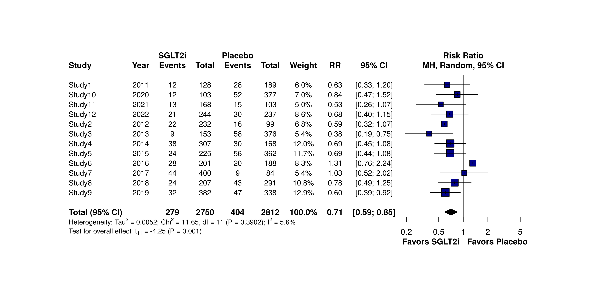
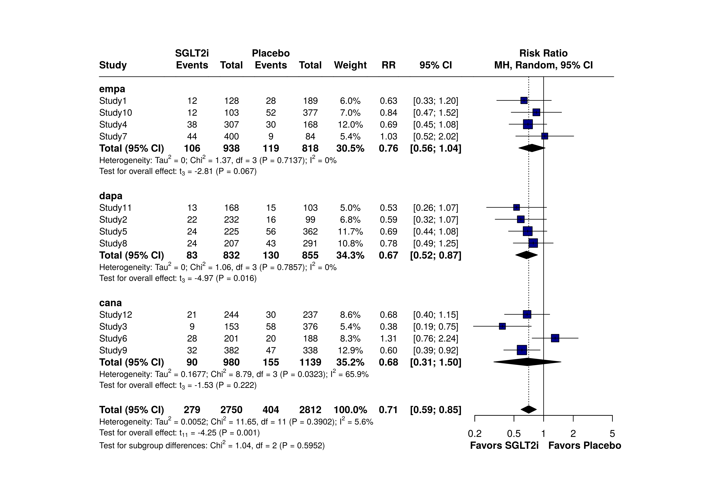
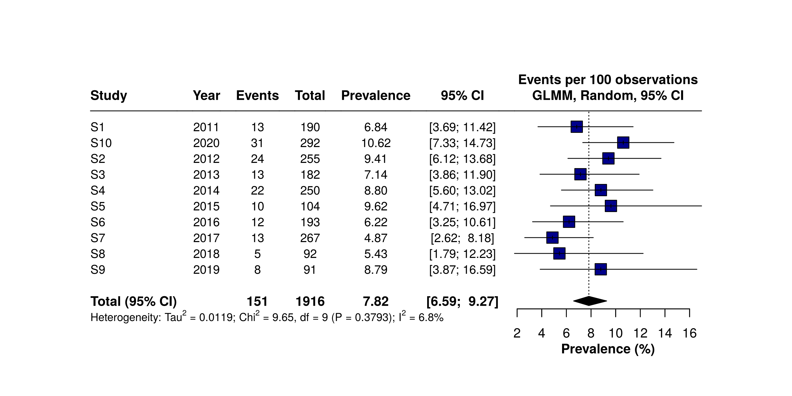
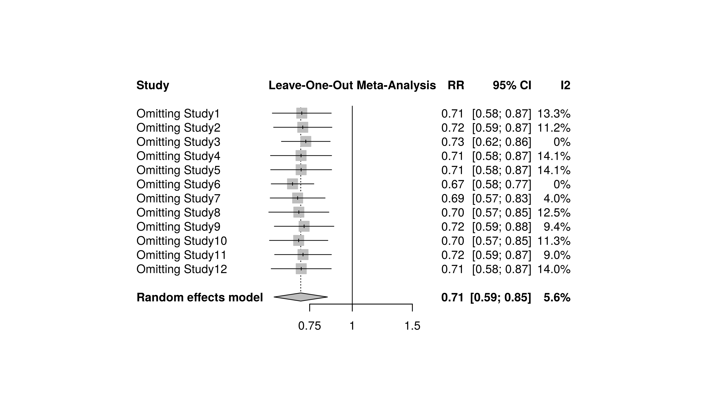
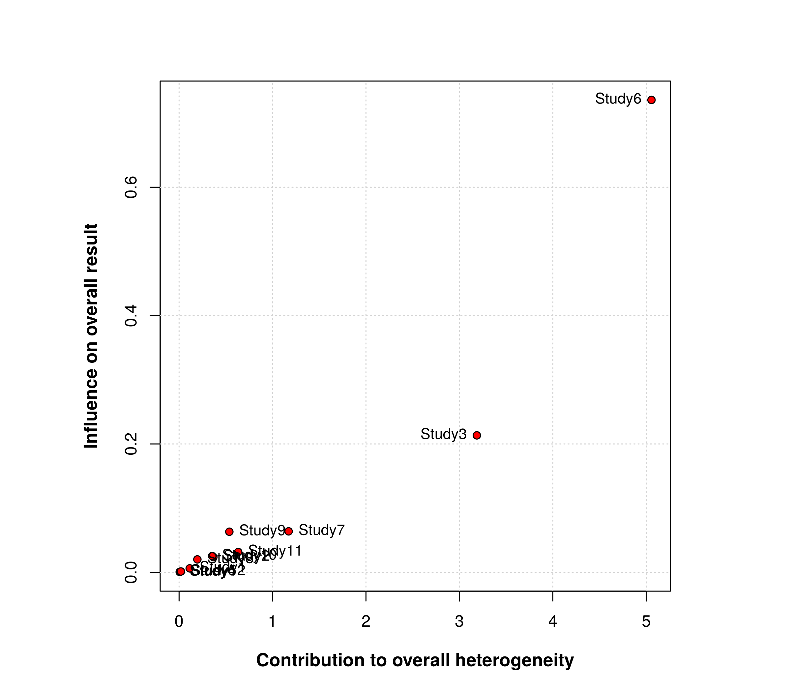
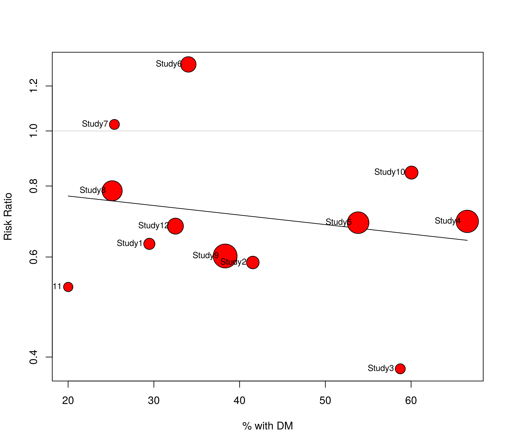
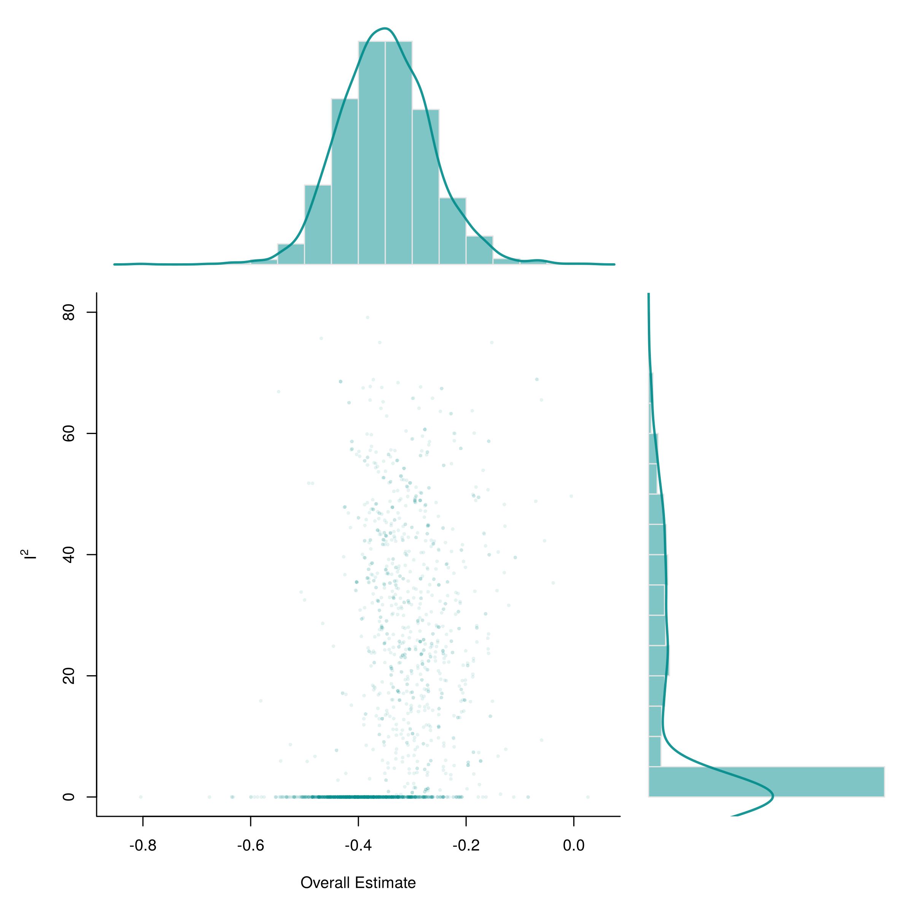
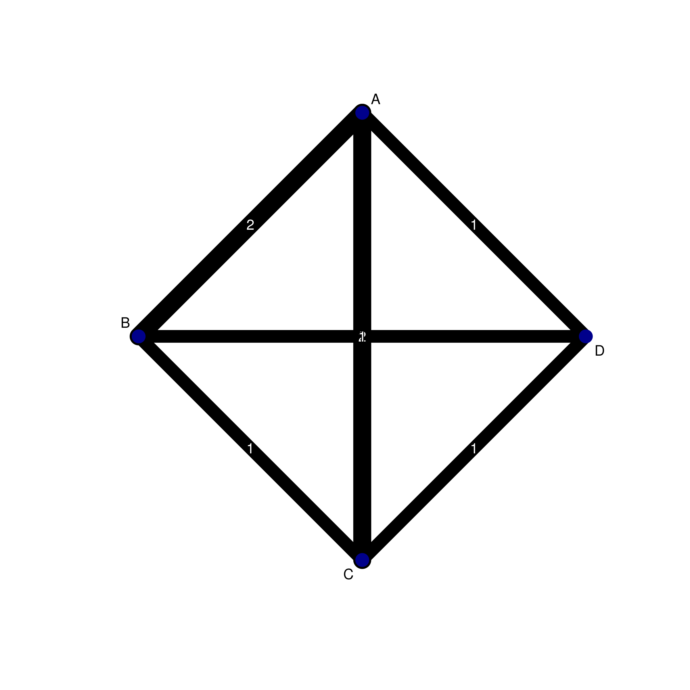
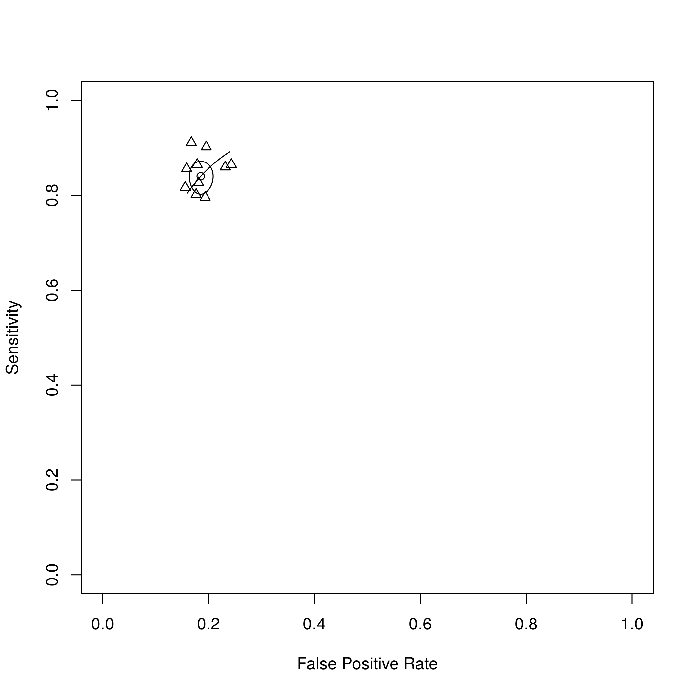

# Meta-Analysis R Toolkit

Reproducible R code for systematic reviews and meta-analyses: pairwise and single-arm pooling, publication-quality forest plots, heterogeneity and sensitivity analyses, publication bias, network meta-analysis and diagnostic test accuracy meta-analysis.

Built on the [`meta`](https://cran.r-project.org/package=meta), [`metafor`](https://cran.r-project.org/package=metafor), [`netmeta`](https://cran.r-project.org/package=netmeta) and [`mada`](https://cran.r-project.org/package=mada) packages. Every template is covered by an end-to-end test script.

<p align="center">
  
</p>

## What's inside

| File | Purpose |
|---|---|
| [`R/ma_toolkit.R`](R/ma_toolkit.R) | Helper functions: import, RevMan-style forest plots, plot saving, effect-size conversion, median→mean, sensitivity bundle, results sentence |
| [`R/01_pairwise_templates.R`](R/01_pairwise_templates.R) | Binary (`metabin`), continuous (`metacont`), generic OR/RR/HR (`metagen`), subgroups |
| [`R/02_single_arm_templates.R`](R/02_single_arm_templates.R) | Proportions (`metaprop`), single means (`metamean`), median/IQR → mean (SD) |
| [`R/03_heterogeneity_bias_templates.R`](R/03_heterogeneity_bias_templates.R) | Leave-one-out, Baujat, influence diagnostics, GOSH, L'Abbé, meta-regression, funnel, Egger, trim-and-fill |
| [`R/04_network_ma_templates.R`](R/04_network_ma_templates.R) | Frequentist NMA (`netmeta`): network graph, league table, P-scores, node-splitting; Bayesian (`gemtc`) block |
| [`R/05_diagnostic_ma_templates.R`](R/05_diagnostic_ma_templates.R) | DTA: pooled sensitivity/specificity, bivariate Reitsma model, SROC/AUC, DOR, Deeks' test, comparing two tests |
| [`R/99_test_all.R`](R/99_test_all.R) | Runs every analysis on simulated data (15 checks) |
| [`examples/quickstart.R`](examples/quickstart.R) | A complete analysis in about 20 lines |

## Quick start

```r
install.packages(c("meta", "metafor", "estmeansd", "readxl", "writexl", "netmeta", "mada", "dplyr"))
```

From the repository root:

```r
source("R/ma_toolkit.R")
ma <- ma_import("examples/data/example_data.xlsx")     # one sheet per outcome

m <- metabin(event.e, n.e, event.c, n.c, data = ma$acm, studlab = Author,
             sm = "RR", method = "MH", method.tau = "PM",
             method.random.ci = "HK", common = FALSE, random = TRUE)

ma_report(m)
#> "RR 0.71 (95% CI 0.59 to 0.85; p=0.001; I²=6%; 12 studies, random-effects model)"

ma_save(ma_forest(m, lab.e = "Intervention", lab.c = "Control", year_col = "Year"),
        "forest_plot", width = 12, height = 6)

ma_sensitivity(m, prefix = "acm")   # leave-one-out, Baujat, funnel, Egger, influence
```

Run the full test suite: `Rscript R/99_test_all.R`

## Data layout

One Excel workbook, one sheet per outcome, column names without spaces:

| Data type | Columns | Function |
|---|---|---|
| Binary, two arms | `Author, Year, event.e, n.e, event.c, n.c` | `metabin` |
| Continuous, two arms | `Author, n.e, mean.e, sd.e, n.c, mean.c, sd.c` | `metacont` |
| Ratio + 95% CI only | `Author, HR, lower, upper` | `metagen` |
| Proportion, one arm | `Author, Year, event, n` | `metaprop` |
| Mean, one arm | `Author, n, mean, sd` | `metamean` |
| Median + IQR/range | `Author, n, median, q1, q3, min, max` | `ma_median_to_mean_df` |
| Network (arm-based) | `study, treatment, responders, sampleSize` | `netmeta` |
| Diagnostic accuracy | `study, TP, FP, FN, TN` | `mada::reitsma` |

## Methodological defaults

| Decision | Default | Switch when |
|---|---|---|
| Model | Random effects | Common effect only with no heterogeneity and a strong rationale |
| Binary pooling | Mantel-Haenszel | Peto for rare events with OR; GLMM for many zero cells |
| τ² estimator | REML (continuous), Paule-Mandel (binary / few studies) | DerSimonian-Laird only to reproduce RevMan |
| Pooled CI | Hartung-Knapp | Wald when many studies |
| Proportions | GLMM with logit transformation | Freeman-Tukey for many 0%/100% studies |
| Median → mean | Quantile estimation (`estmeansd::qe.mean.sd`) | Box-Cox as sensitivity |
| Publication bias tests | Only with ≥ 10 studies | Funnel plot inspection otherwise |

## Example outputs (simulated data)

| Subgroup forest plot | Proportion meta-analysis |
|---|---|
|  |  |
| **Leave-one-out** | **Baujat plot** |
|  |  |
| **Meta-regression bubble plot** | **GOSH plot** |
|  |  |
| **Network graph** | **SROC curve (diagnostic accuracy)** |
|  |  |

All example data are simulated and do not represent real trials.

## Not covered in R

Trial Sequential Analysis is run in the Copenhagen Trial Unit's [TSA software](https://ctu.dk/tsa/) from a RevMan 5 CSV export.

## Tested with

R 4.x · meta 8.5 · metafor 5.2 · netmeta 3.7 · mada 0.5 · estmeansd 1.0. The toolkit detects the `lab.e`/`label.e` rename in meta ≥ 8 automatically.

## References

- Balduzzi S, Rücker G, Schwarzer G. How to perform a meta-analysis with R: a practical tutorial. *Evid Based Ment Health*. 2019;22:153–160.
- Harrer M, Cuijpers P, Furukawa TA, Ebert DD. *Doing Meta-Analysis with R: A Hands-On Guide*. CRC Press; 2021.
- Higgins JPT, Thompson SG. Quantifying heterogeneity in a meta-analysis. *Stat Med*. 2002;21:1539–1558.
- Viechtbauer W, Cheung MW. Outlier and influence diagnostics for meta-analysis. *Res Synth Methods*. 2010;1:112–125.
- Reitsma JB, et al. Bivariate analysis of sensitivity and specificity produces informative summary measures in diagnostic reviews. *J Clin Epidemiol*. 2005;58:982–990.
- McGrath S, et al. Estimating the sample mean and standard deviation from commonly reported quantiles in meta-analysis. *Stat Methods Med Res*. 2020;29:2520–2537.

## Acknowledgments

The analysis pipeline follows the structure taught in the Meta-Analysis Academy course *Doing Meta-Analysis with R*.

## Author

**Zahin Shahriar**, MBBS (Dhaka Medical College) · [GitHub](https://github.com/zahinS007)

## License

[MIT](LICENSE)
